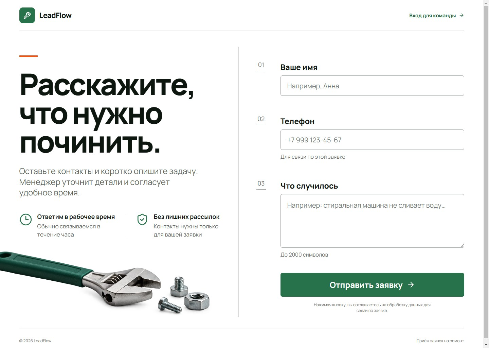
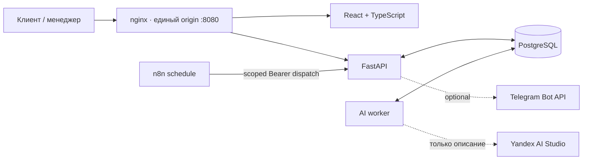

# LeadFlow

Production-minded сервис заявок для небольшой ремонтной компании. Клиент отправляет обращение без регистрации, менеджер ведёт его в защищённом кабинете, а внешние AI- и Telegram-интеграции подключаются опционально и не блокируют основной сценарий.



[Кейс проекта](docs/PORTFOLIO_CASE.md) · [Сценарий демо](docs/DEMO_SCRIPT.md) · [Галерея экранов](docs/portfolio/README.md) · [Запуск и настройка](docs/LOCAL_SETUP.md)

## Что умеет продукт

- публичная адаптивная форма с идемпотентной отправкой;
- защищённый кабинет: вход, список, поиск, фильтры и пагинация;
- карточка заявки, смена статуса и история изменений;
- HttpOnly cookie-сессии, проверка `Origin` и rate limiting;
- асинхронный разбор описания на услугу, бюджет и срок через Yandex AI Studio;
- ручная коррекция разбора с optimistic revision conflict protection;
- durable outbox Telegram: новая заявка и одно напоминание через 30 минут;
- два n8n workflow, которые только запускают защищённый backend dispatch.

Без внешних credentials LeadFlow остаётся полноценным локальным демо: AI показывает честное состояние «Не подключено», доступна ручная коррекция, Telegram-отправка выключена, а n8n workflow неактивны.

## Архитектура



Frontend не получает внешние ключи. PostgreSQL — единственная база приложения. Миграции выполняются до старта API; AI worker и n8n запускаются отдельно. Backend, а не n8n, владеет правилами уведомлений, дедупликацией, retry и финальным состоянием доставки.

## Стек

- React 19, TypeScript, Vite, React Router;
- FastAPI, SQLAlchemy 2, Alembic, Pydantic;
- PostgreSQL 17;
- nginx и Docker Compose-конфигурация;
- n8n 2.44.6 для расписания уведомлений;
- Pytest, Ruff, Vitest, Testing Library и browser QA.

## Подтверждённое качество

Последние зафиксированные результаты: backend suite повторно запущен для финального review на
отдельной PostgreSQL-БД; frontend результат относится к последней функциональной регрессии:

| Область | Результат |
| --- | --- |
| Backend | `54 passed` на PostgreSQL 17.11; Ruff и compileall без ошибок |
| Frontend | `24 passed`; production build успешно (`1604` modules) |
| Browser flow | submit → login → list/search/filter → detail → status/history → manual extraction → logout/guard |
| Конкурентная правка | реальный конфликт двух вкладок `409`, черновик сохранён, выбор версии явный |
| Mobile/accessibility | AI-панель `390×844`, DPR 1, без overflow; keyboard focus проверен |
| AI pipeline | отдельная PostgreSQL-БД и loopback provider: retry, structured result, evidence, revision guard |
| Notifications | настоящий n8n runtime и schedule triggers на loopback Telegram fixture |
| Recovery | реальный PostgreSQL outage во время `processing`, lease recovery без дубля |
| Backup/restore | app+n8n dumps восстановлены в новые БД; backend/worker/n8n restart persistence прошёл |

Подробная доказательная база и ограничения: [HANDOFF](docs/HANDOFF.md),
[финальный review](docs/FINAL_REVIEW.md) и [release checklist](docs/RELEASE_CHECKLIST.md).

## Быстрый локальный запуск

Docker Compose-конфигурация подготовлена, но на исходной QA-машине Docker отсутствовал, поэтому контейнерный запуск ещё требует проверки в среде с Docker.

```powershell
Copy-Item .env.example .env
# Замените все change-me значения локальными случайными секретами.
docker compose up --build -d
docker compose ps
docker compose exec backend python -m app.cli create-manager
```

После health checks приложение доступно на `http://localhost:8080`. Обычный `docker compose down` сохраняет named volumes; `docker compose down -v` удаляет данные.

Проверенный Windows-контур использует portable PostgreSQL без SQLite и без Windows-службы. Полная подготовка зависимостей и команды запуска находятся в [docs/LOCAL_SETUP.md](docs/LOCAL_SETUP.md).

Для повторяемого набора из шести синтетических заявок:

```powershell
.\scripts\manage-local-demo-data.ps1 seed
```

Команда идемпотентна. Scoped reset требует явного `-ConfirmReset` и удаляет только owned demo rows. Credentials менеджера находятся только в игнорируемой `.runtime/demo-credentials.env`.

## Честные ограничения

- Проект учебный и не использовался реальными клиентами; бизнес-метрики не заявляются.
- Live-качество Yandex AI Studio не измерялось без пользовательского ключа. Fixture-тесты не являются оценкой точности модели.
- Telegram transport проверен на loopback fixture, но живой бот и чат не подключались.
- Docker Compose прошёл статические проверки, но не запускался на исходной машине.
- Подтверждён локальный адрес, а не публичный hosting/HTTPS.
- Rate limit хранится в памяти одного backend-процесса; текущий scope — одна компания и один менеджер.
- Native Chrome text zoom 200% и screen-reader проход остаются незакрытыми; deterministic 200% reflow проверен отдельно.
- Bitrix24 не входит в текущую версию.

## Документация

- [Портфолио-кейс](docs/PORTFOLIO_CASE.md)
- [Сценарий демо](docs/DEMO_SCRIPT.md)
- [Галерея и подписи](docs/portfolio/README.md)
- [Локальная установка](docs/LOCAL_SETUP.md)
- [Backup и restore](docs/BACKUP_RESTORE.md)
- [Контекст и scope](docs/PROJECT_CONTEXT.md)
- [Проверенный статус](docs/HANDOFF.md)
- [Подготовка репозитория](docs/REPOSITORY_PREPARATION.md)
- [Чек-лист перед публикацией](docs/RELEASE_CHECKLIST.md)

Проект создан в AI-assisted процессе: продуктовый scope, ограничения, архитектурные решения и приёмка оставались за человеком; реализация, тесты и документация создавались совместно с AI-ассистентами.
