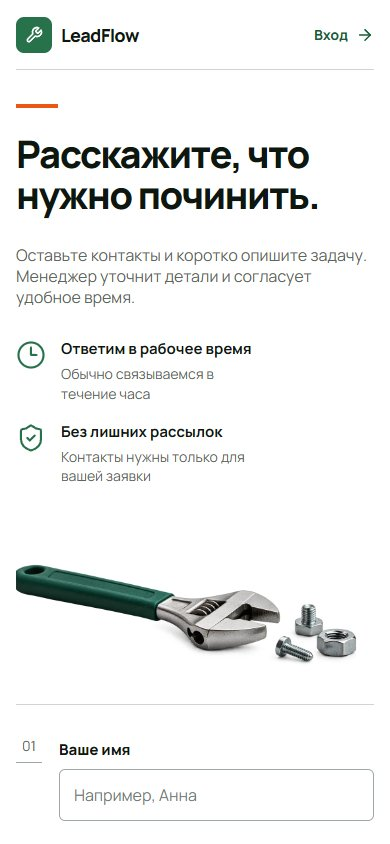
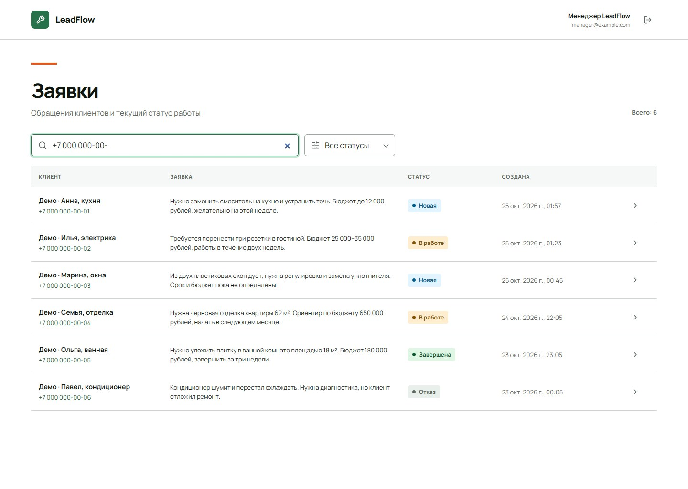
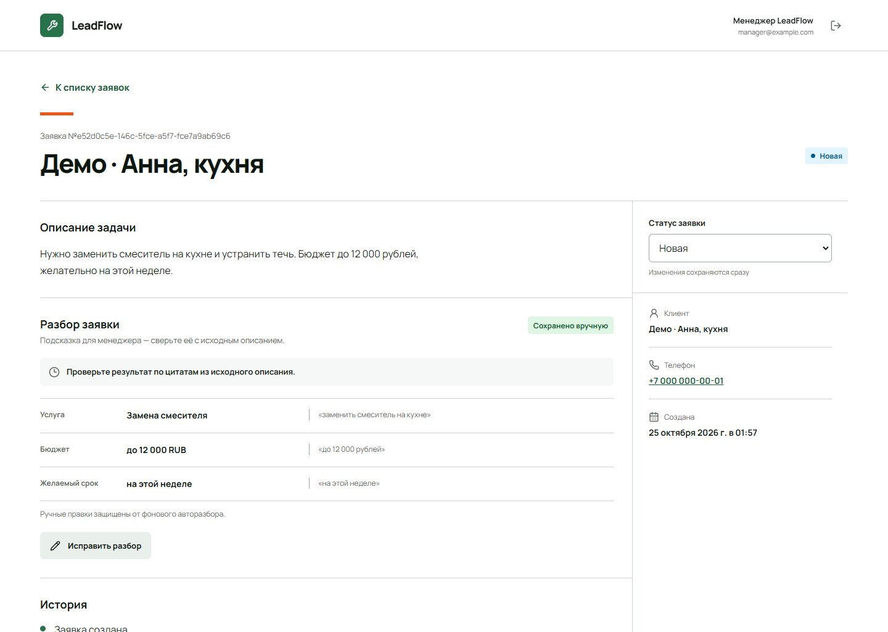
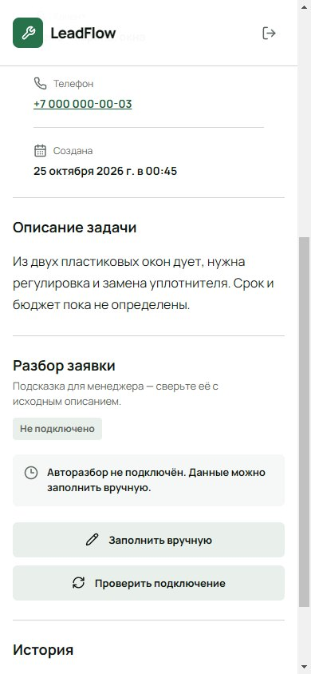
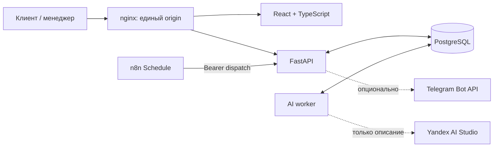

# LeadFlow — кейс для портфолио

## Коротко о проекте

LeadFlow — учебный production-minded сервис заявок для небольшой ремонтной компании. Клиент оставляет обращение без регистрации, менеджер обрабатывает его в защищённом кабинете, а опциональные интеграции помогают разобрать свободный текст и не пропустить новую заявку.

Проект не использовался реальными клиентами, поэтому здесь нет выдуманных метрик, экономии или бизнес-результатов. Ценность показана через законченный пользовательский путь и проверяемые инженерные решения.

_Публичная форма, реальное локальное приложение, 1440 × 1024. Основной кадр кейса._

## Проблема

Заявка на ремонт часто начинается с неструктурированного сообщения: что сломалось, какой есть бюджет и когда нужен мастер. Если обращения приходят в разные каналы, менеджеру приходится вручную переносить данные, уточнять контекст и следить, чтобы новая заявка не осталась без реакции.

## Путь пользователя

1. Клиент отправляет имя, телефон и описание задачи в адаптивной форме без регистрации.
2. Менеджер входит в защищённый кабинет, находит обращение через поиск и фильтры и открывает карточку.
3. В карточке остаётся исходное описание, меняется статус и пополняется история.
4. Если AI подключён, отдельный worker предлагает услугу, бюджет и срок вместе с цитатами. Без ключа интерфейс честно показывает «Не подключено», а менеджер может заполнить поля вручную.
5. Опциональные расписания n8n запускают обработку уведомления о новой заявке и одного напоминания через 30 минут.

Повтор сетевого запроса формы не создаёт дубль: неизменённая отправка использует один клиентский UUID, а идемпотентность обеспечивается сервером и PostgreSQL.

_Та же форма при точном viewport 390 × 844: основной сценарий начинается без горизонтальной прокрутки._

_Поиск оставляет в списке только шесть детерминированных синтетических заявок `Демо · …`; реальные данные в кадр не попали._

## Решения, которые делают сценарий надёжнее

- **Основной путь не зависит от внешнего AI.** API и очередь разделены; отсутствие ключа даёт стабильное состояние `not_configured`, а не фиктивный ответ или бесконечную загрузку.
- **Разбор можно проверить.** Структурированные поля показаны рядом с дословными фрагментами исходного описания; неизвестные значения обозначаются «Не указано».
- **Ручные правки защищены.** Сохранение передаёт ожидаемую ревизию. При конфликте черновик остаётся у менеджера, который явно выбирает свои или свежие серверные данные.
- **Уведомления переживают временные сбои.** PostgreSQL outbox отвечает за владение задачей, дедупликацию и ограниченные повторные попытки. Неоднозначный результат внешней отправки помечается отдельно и не отправляется повторно автоматически; это не обещание exactly-once доставки.
- **Секреты не попадают в браузер и репозиторий.** AI-ключ, bot token, chat id, service token и пароли остаются в локальном окружении.

_Реальный экран карточки с синтетическими данными. Значения сохранены вручную при подготовке demo seed — это не результат live-вызова Yandex._

_Реальное состояние `not_configured` при 390 × 844: доступны ручное заполнение и повторная проверка подключения._

## Архитектура

Frontend не получает ключи AI или Telegram. В AI-провайдер уходит только поле описания: отдельные поля имени и телефона не отправляются. Если клиент сам написал контактные данные внутри описания, они станут частью отправляемого текста — это важное ограничение текущего MVP. n8n хранит расписание и защищённый вызов backend; правила доставки и состояние сообщений находятся в PostgreSQL.

## Что реализовано

- публичная форма и защищённый кабинет на одном origin;
- HttpOnly cookie-сессии, проверка `Origin`, rate limiting и серверная валидация;
- поиск, фильтры, пагинация, статусы и история заявки;
- PostgreSQL как единственная база приложения, обязательные Alembic-миграции и сохранение данных после перезапуска;
- асинхронная AI-очередь с отдельным worker, retry и защитой ручных правок;
- durable notification outbox, initial alert, одно напоминание и отмена напоминания после взятия заявки в работу;
- два импортируемых n8n workflow: для новых заявок и напоминаний;
- адаптивный интерфейс «Сервисный бланк» с русскими состояниями загрузки, ошибок и пустых данных.

## Стек

- Frontend: React 19, TypeScript, Vite, React Router, Manrope, Lucide.
- Backend: Python, FastAPI, SQLAlchemy 2, Alembic, Pydantic, `httpx`.
- Data: PostgreSQL 17.
- Automation: n8n 2.44.6, Telegram Bot API через backend transport.
- Delivery: nginx, Docker Compose-конфигурация и отдельные процессы API/worker.
- Quality: Vitest + Testing Library, Pytest, Ruff, интеграционные PowerShell/Python-сценарии и browser QA.

## Проверенный результат

По последним зафиксированным прогонам из проектного handoff:

- backend: `54 passed`, Ruff и `compileall` без ошибок;
- frontend: `24 passed`, production build успешен;
- реальный browser flow прошёл путь «форма → вход → список/поиск/фильтр → карточка → статус/история → ручной разбор/конфликт → logout guard» на общей PostgreSQL;
- шесть синтетических demo-заявок добавляются идемпотентно и не создают notification outbox;
- recovery drill дважды восстановил дампы приложения и n8n на изолированной PostgreSQL; lease AI-задачи был возвращён и завершён без дублирования результата;
- n8n workflow выполнены на loopback Telegram fixture, а AI pipeline — на локальном mock-провайдере.

Это не новый тестовый прогон во время сборки кейса. Docker runtime в текущей среде не был доступен, поэтому чистый Docker Compose bring-up остаётся отдельной проверкой.

## Границы демонстрации

Локальный portfolio-вариант уже самодостаточен: репозиторий, этот кейс, реальные скриншоты и локальный demo flow. Yandex AI Studio и Telegram сейчас не подключены к живым аккаунтам; подготовленные интеграции нельзя выдавать за live-результат. Публичный хостинг и видео остаются опциональным продолжением, а не условием честной локальной демонстрации.

## Как велась разработка

Проект создан в AI-assisted процессе. Человек определял продуктовый scope и ограничения, выбирал сценарии и внешние сервисы, принимал UX и архитектурные решения и проверял результат. AI-ассистенты помогали с реализацией, тестами, документацией и поиском дефектов. Это не следует описывать как полностью вручную написанный код.

## Материалы

- [Manifest скриншотов и provenance](portfolio/README.md)
- [Сценарий локального демо на 2–3 минуты](DEMO_SCRIPT.md)
- [Чек-лист подготовки к публикации](RELEASE_CHECKLIST.md)
- Короткое видео — **нужно подготовить**, если оно понадобится для конкретной площадки.
- Hosted URL — **не подготовлен**; локальный portfolio-вариант не зависит от него.

## Готовое описание для резюме

> LeadFlow — учебный production-minded full-stack сервис заявок ремонтной компании: адаптивная форма, защищённый кабинет менеджера, PostgreSQL, опциональный разбор текста через Yandex AI Studio и подготовленные Telegram-уведомления через n8n. Реализованы идемпотентная отправка, HttpOnly-сессии, история статусов, durable worker/outbox, ручная коррекция с защитой от гонок и graceful degradation без внешних ключей. Стек: React, TypeScript, FastAPI, SQLAlchemy, Alembic, PostgreSQL, nginx, n8n.

Честная формулировка роли:

> Вёл AI-assisted разработку проекта: определял продуктовый scope и ограничения, принимал UX и архитектурные решения, проверял сценарии и качество результата; реализация, тесты и документация создавались совместно с AI-ассистентами.

Согласованный финальный pre-publication review завершён со статусом PASS для локального package;
[отчёт](FINAL_REVIEW.md). Владелец позднее разрешил публичную GitHub-публикацию исходников.
Публичный hosting/деплой приложения и подключение live Yandex/Telegram этим решением не заявляются.
